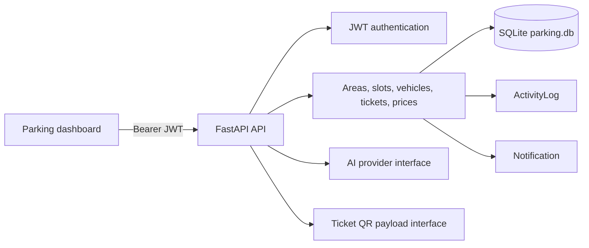
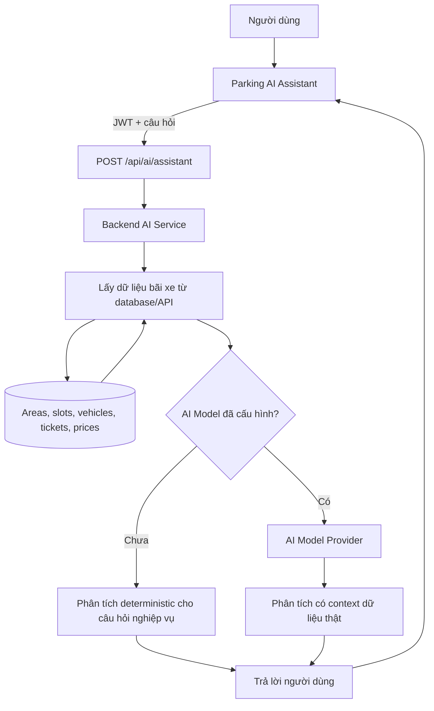

# Parking AI Architecture

## Current runtime

The active application is the `backend` directory: FastAPI, SQLAlchemy and SQLite. The HTML client is served by FastAPI at `/parking`. The `database/backend` tree is a legacy duplicate and is not used by the current launch configuration.

## Extension boundaries

## Parking AI request flow

The target product flow is:

Các câu hỏi nghiệp vụ được trả lời từ dữ liệu CSDL, gồm lưu lượng theo ngày/tuần, giờ cao điểm theo ngày-giờ Việt Nam và ước tính nhân sự. Ước tính mặc định dùng giả định 10 lượt xe/nhân viên/giờ, có thể chỉnh qua `AI_ARRIVALS_PER_EMPLOYEE_PER_HOUR`; đây không phải dự báo hoặc lịch phân ca. Khi có đủ `AI_BASE_URL`, `AI_API_KEY` và `AI_MODEL`, provider xử lý câu hỏi chưa có intent deterministic và diễn giải gợi ý nhân sự dựa trên số liệu backend đã tính. Số nhân sự do backend tính vẫn là dữ liệu có thẩm quyền; nếu provider lỗi, assistant trả fallback deterministic và thông báo trạng thái. Không có số liệu nào được giả lập khi CSDL không có dữ liệu.

- **Domain API:** existing areas, slots, vehicles, tickets and prices remain the source of truth.
- **Dashboard:** `/api/dashboard/summary` and `/api/revenue` calculate metrics from database rows. The browser refreshes the summary periodically so the first real-time version does not expose a token in an SSE query string.
- **Visualization:** parking cards are rendered from area/slot responses. A slot detail endpoint is available at `/api/slots/{slot_id}`.
- **Authorization:** accepted roles are `admin`, `employee`/`staff`, and `customer`; `staff` is normalized to `employee`. The current runtime does not accept a `manager` role.
- **Audit:** `/api/audit-logs` reads `activity_logs`; ticket entry and exit currently create audit records.
- **Notifications:** `/api/notifications` reads database-backed notifications; ticket entry and exit create notifications from real events.
- **QR:** `/api/tickets/{ticket_id}/qr` returns a versioned payload for a QR renderer. No fake image is returned when no QR renderer is configured.
- **AI:** `/api/ai/assistant` handles supported factual questions and traffic summaries from current database data. Staffing is a configurable heuristic; a configured provider may interpret it without changing the calculated count. Provider failures fall back to the rule-based estimate with an explicit notice. `/api/ai/capabilities` reports chatbot/staffing status separately from unimplemented occupancy forecasting and license-plate recognition. `/api/ai/query` returns `501` until a provider is configured.
- **Backup:** `backup_database.py` and `restore_database.py` use SQLite's online backup API. Restore should be run with the application stopped and a verified backup path.

## Production migration path

1. Move SQLite to PostgreSQL behind the existing SQLAlchemy session boundary.
2. Add Alembic migrations before adding non-null business fields.
3. Replace polling with authenticated WebSocket/SSE transport when deployment supports connection authentication.
4. Add a real reservation table and state machine instead of overloading slot status.
5. Add a QR renderer/signing key and verify ticket payloads server-side.
6. Configure an AI provider through environment variables and keep provider calls isolated from domain writes.
7. Add rate limiting, secret management, HTTPS, CORS allowlists, structured logs and automated backups.

## Data constraints still requiring product decisions

The current schema has no phone number, floor, slot type, reservation entity, cancellation state or price effective dates. Those should be added through explicit migrations and business rules rather than inferred or filled with placeholder values.
